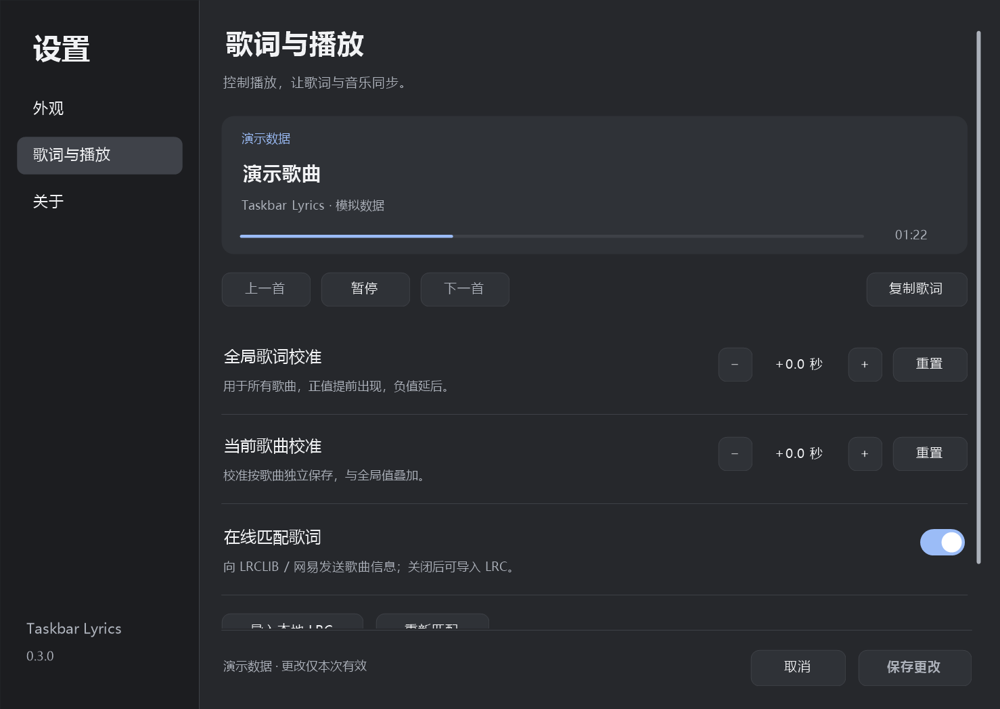

<p align="center"></p>

# Taskbar Lyrics · 任务栏歌词

Windows 任务栏同步歌词工具。通过系统媒体会话读取正在播放的歌曲和进度，在任务栏空闲区域显示透明歌词。

**v0.3.0** · C++20 / Win32 / C++/WinRT · Windows 10 2004+ / Windows 11 x64 · [MIT License](LICENSE)

## 下载与运行

从 [GitHub Actions](https://github.com/SaturdayF/taskbar-lyrics/actions/workflows/build.yml) 最近成功的构建下载 `TaskbarLyrics-native-win-x64` 构件，解开其中的 `TaskbarLyrics-Native-0.3.0-win-x64.zip`，运行 `TaskbarLyrics.Native.exe`。下载 Actions 构件需登录 GitHub。

程序无需安装 .NET、WebView2 或单独的 VC++ 运行库。图标内嵌，关闭菜单后继续在系统托盘运行。

1. 打开 QQ 音乐、网易云音乐或 Apple Music/iTunes，并开启播放器的系统媒体控制（SMTC）。
2. 播放歌曲，程序自动匹配同步歌词；没有歌词时显示歌曲信息。
3. 按住左侧手柄横向拖动。右键歌词或托盘图标可控制播放、校准歌词、导入 LRC 和调整显示行为。
   选择“设置…”或双击托盘图标，打开设置窗口。
4. 从托盘菜单退出。程序不创建自动启动项。

离线演示无需播放器，也不会请求在线歌词。

```powershell
.\TaskbarLyrics.Native.exe --demo --offline
```

## 功能

- **原生设置页**：外观、歌词与播放、关于三页，支持浅深色主题、歌词字号与预览、键盘操作及窗口缩放；偏好修改后保存，取消不改变现有设置。
- **透明任务栏歌词**：以任务栏中心为基准，垂直位置固定，支持左右拖动；自动避开任务栏按钮和通知区域。
- **空间适配**：可用区域不足时缩短歌词栏；没有可读空间、任务栏隐藏、检测过期或当前屏幕有全屏应用时隐藏。
- **播放控制**：上一首、播放或暂停、下一首，按播放器报告的可用操作启用菜单。
- **单曲与全局校准**：每项 ±10 秒，叠加生效，切歌及重启后保留；校准不改变播放器进度。
- **暂停隐藏**：可选暂停或无播放时隐藏，恢复播放后自动显示；托盘控制始终可用。
- **鼠标穿透**：可让点击交给下方任务栏；从托盘关闭后恢复拖动、滚轮和右键交互。
- **复制歌词**：复制当前同步歌词正文；前奏、空白间奏和未匹配状态不复制占位文本。
- **本地 LRC**：支持导入带时间戳的 UTF-8 LRC，最大 2 MB，仅当前歌曲会话有效。
- **状态诊断**：查看当前歌曲、匹配来源、控制结果，手动重试或恢复居中。

## 快捷操作

| 操作 | 入口 | 行为 |
| --- | --- | --- |
| 设置页 | 右键“设置…”、双击托盘或 `--settings` | 字号、显示偏好、在线匹配和校准可在同一窗口修改 |
| 单曲校准 | 右键“歌词校准”；`Ctrl + 滚轮` | 每格 0.5 秒，向上提前、向下延后 |
| 全局校准 | 右键“歌词校准”；`Ctrl + Shift + 滚轮` | 与单曲校准叠加，用于所有歌曲 |
| 重置校准 | 右键“歌词校准”子菜单 | 单曲和全局可分别重置 |
| 暂停隐藏、鼠标穿透 | 歌词或托盘右键菜单 | 默认关闭，开关自动保存 |
| 复制当前歌词 | 歌词或托盘右键菜单 | 复制当前同步行 |
| 悬浮模式 | 取消“在任务栏空闲区域显示”或使用 `--floating` | 切换为可自由移动的悬浮窗口 |

单曲以播放器、歌名、歌手和专辑区分，不依赖可能暂时缺失的媒体时长；元数据完全相同的录音共用校准。正值让歌词提前出现。鼠标穿透开启时，歌词栏不接收鼠标操作，需从托盘关闭。

设置页的主题切换和字号修改可先预览，点击“保存更改”或 `Ctrl + S` 后应用；“取消”或关闭窗口丢弃未保存修改。播放控制、导入、重新匹配及恢复居中立即执行。切歌时，各首歌的未保存校准分别保留，保存时不会覆盖其他未修改的托盘设置。




## 播放器与歌词来源

| 播放器 | 歌曲及进度 | 歌词来源 |
| --- | --- | --- |
| QQ 音乐 Windows 客户端 | Windows SMTC | LRCLIB，失败回退网易公开接口；支持本地 LRC |
| 网易云音乐 Windows 客户端 | Windows SMTC | LRCLIB，失败回退网易公开接口；支持本地 LRC |
| Apple Music / iTunes | Windows SMTC | LRCLIB，失败回退网易公开接口；支持本地 LRC |

歌词匹配校验歌名、歌手和可用时长，候选搜索优先同专辑结果。媒体会话不直接提供歌词正文。网络或来源收录会影响匹配结果，失败后约 30 秒重试，也可手动重试。

播放器需提供 SMTC 歌曲和进度信息。真实客户端的同步、暂停、切歌及拖动进度仍需按客户端版本逐一验收；公开样例歌词查询成功不等同于客户端端到端验证。

## 数据与兼容范围

- 校准、暂停隐藏、鼠标穿透、字号、设置页主题、在线匹配及停靠开关保存在 `%LOCALAPPDATA%\TaskbarLyrics\Native\settings.json`，通过临时文件替换保存。`--demo` 启动时使用独立默认设置，不写入正式设置。
- 本地导入的歌词和窗口位置暂不持久化；无在线歌词磁盘缓存。
- 在线匹配向 LRCLIB 或网易发送歌曲元数据及匹配歌曲 ID。菜单可关闭在线匹配，`--offline` 可禁止启动后的在线查询。
- 不读取登录凭据或 Cookie，无遥测及音频上传、下载。歌词权利归其权利人所有。
- 使用透明置顶窗口，不向 Explorer 注入代码或修改任务栏布局；适配 Windows 标准水平任务栏。
- 当前在窗口所在屏幕显示，支持识别主屏和副屏任务栏；尚不支持同时在全部屏幕显示或保存各屏位置。副屏需开启任务栏显示。
- 设置页与托盘菜单同时可用。多屏混合 DPI、自动隐藏和不同 Windows 版本仍需进一步实机验证。
- 媒体、歌词和任务栏检测在独立线程运行；切歌会丢弃旧歌结果，同步网络请求仍可能等待超时。

## 开发与验证

需要 Visual Studio 2022 C++ 桌面工具及 Windows SDK，运行以下命令生成便携包。

```powershell
.\scripts\build.ps1
# 安装包另需 Inno Setup 6.3+ 或 7
.\scripts\build.ps1 -Iscc 'C:\Program Files (x86)\Inno Setup 6\ISCC.exe'
# 使用模拟歌曲检查实际窗口，不控制真实播放器
.\scripts\check-native.ps1 -Docked -Interactions
```

构建包含 24 项核心检查、Unicode 设置读写检查和 17 项原生设置页检查。便携产物位于 `artifacts/native-win-x64/` 和 `artifacts/TaskbarLyrics-Native-0.3.0-win-x64.zip`；启用 Inno Setup 时生成 `TaskbarLyrics-Native-0.3.0-setup-x64.exe`，安装仅针对当前用户。

| 路径 | 内容 |
| --- | --- |
| `native/main.cpp` | 媒体会话、在线匹配、透明窗口及托盘菜单 |
| `native/settings-ui.cpp` | 原生设置页、主题、预览、交互及界面检查 |
| `native/lyrics.h`、`native/layout.h` | LRC 解析、时间定位及任务栏空闲区计算 |
| `native/preferences.h`、`native/preferences-store.h` | 校准、显示偏好和设置保存 |
| `native/tests.cpp` | 无播放器依赖的核心检查 |
| `scripts` | 构建、窗口检查、安装检查与图标封装 |
| `assets` | PNG 和多尺寸 Windows ICO |

[构建与诊断](native/README.md) · [验证记录](docs/VALIDATION.md) · [相关项目对照](docs/RELATED_PROJECTS.md)

接口参考：[Windows SMTC](https://learn.microsoft.com/en-us/uwp/api/windows.media.control.globalsystemmediatransportcontrolssessionmanager)、[LRCLIB](https://lrclib.net/docs)。
