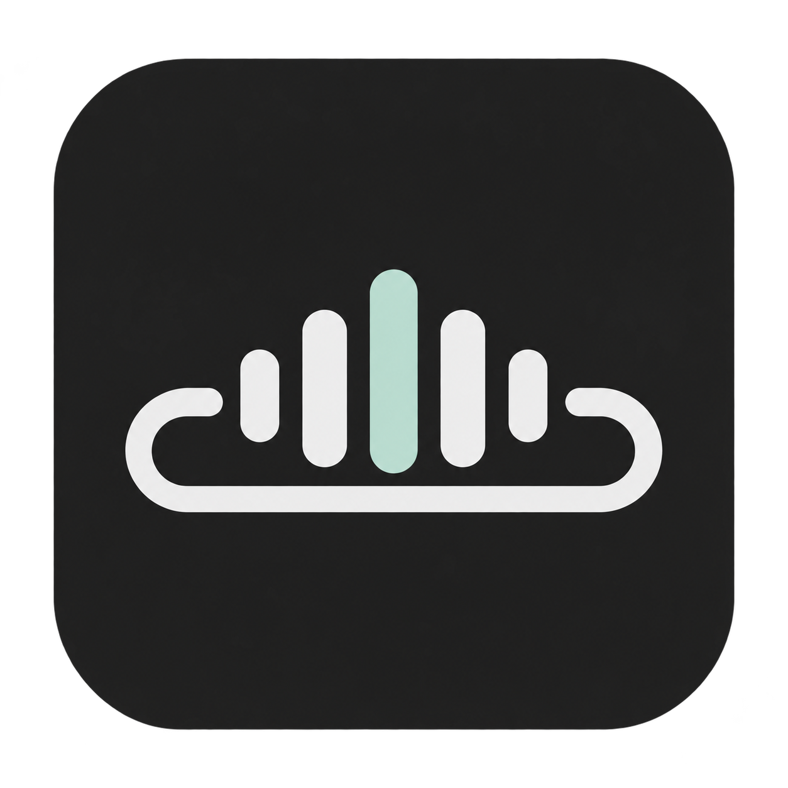

<p align="center"></p>

# Taskbar Lyrics · 任务栏歌词

Windows 任务栏同步歌词工具，通过系统媒体会话获取当前播放歌曲的信息和进度，在任务栏区域显示对应歌词。

**当前版本：v0.3.0** · Windows 10/11 x64 · C# / .NET 8 / WPF · [验证记录](docs/VALIDATION.md) · [MIT License](LICENSE)

## 功能

- 歌词以任务栏中心为基准，垂直位置固定，仅支持左右拖动。
- 自动避让任务栏按钮和通知区域，优先移动，空间不足时缩短宽度；没有可读空间时隐藏。
- 支持仅主屏、指定显示器和全部显示器，各屏独立保存水平位置；指定屏幕断开后暂用主屏，恢复连接后重新使用。
- 支持锁定位置和一键恢复居中，自动避让不会覆盖保存的水平位置。
- 自动跟随正在播放的 QQ 音乐、网易云音乐或 Apple Music，也可指定播放器。
- 支持行级 LRC 同步、字号调整、±10 秒时间微调、本地歌词导入和在线匹配。
- 设置界面分为“正在播放”“外观与位置”“歌词与来源”，支持实时预览和自动保存。
- 通过系统托盘打开设置、恢复位置或退出；程序和窗口内嵌应用图标。

## 播放器与歌词来源

| 播放器 | 歌曲及进度 | 歌词来源 |
| --- | --- | --- |
| QQ 音乐 Windows 客户端 | Windows SMTC 媒体会话 | QQ 歌曲搜索与 LRC 接口，失败回退 LRCLIB；支持导入 LRC |
| 网易云音乐 Windows 客户端 | Windows SMTC 媒体会话 | 网易歌曲搜索与 LRC 接口，失败回退 LRCLIB；支持导入 LRC |
| Apple Music Windows 客户端 / iTunes | Windows SMTC 媒体会话 | 按歌名、歌手、专辑、时长匹配 LRCLIB；支持导入 LRC |

Windows 系统媒体会话提供歌曲信息和播放时间，歌词文本由上表中的在线来源或本地 LRC 提供。Apple Music 的歌词通过 LRCLIB 匹配或本地导入获取。QQ／网易接口的可用性可能受客户端版本、地区和服务端策略影响。未找到同步歌词时显示歌曲信息。

客户端需开启“系统媒体控制 / SMTC / 与系统媒体控件集成”，具体名称随版本变化。

## 运行

系统要求：Windows 10 2004（19041）及以上，x64。`scripts/build.ps1 -Publish` 生成包含 .NET 运行时的便携版。

1. 解压便携包并打开 `TaskbarLyrics.App.exe`。
2. 在支持的播放器中播放音乐；自动模式优先选择正在播放的会话。
3. 歌词默认在主屏显示，自动寻找任务栏空闲位置。拖动仅调整横向位置，纵向固定在任务栏中心；双击或右键进入设置。
4. 在“外观与位置 → 显示器与图标避让”选择仅主屏、指定显示器或全部显示器，并设置自动避让开关。
5. 设置支持选择播放器、调整字号、±10 秒时间偏移、锁定位置、关闭在线匹配、导入当前歌曲的 LRC 和重新匹配。
6. 关闭设置后程序继续运行，从系统托盘菜单或歌词右键菜单退出。

## 图标避让与多屏

- 后台约每秒读取各屏任务栏的可点击区域，保留按钮和通知区域周围的间距。
- 优先在空闲区域保持完整宽度；空间有限时缩短歌词栏，长句以省略号显示；可用宽度不足 160 逻辑像素时隐藏。
- 任务栏布局读取失败或缓存超过 8 秒时暂时隐藏，检测恢复后重新显示。关闭自动避让后可手动调整位置。
- 只在实际存在任务栏的屏幕显示；指定屏幕的任务栏不可用时使用主屏或其他可用任务栏。副屏需在 Windows 设置中开启任务栏显示。
- 位置按 Windows 显示设备名分别保存，支持负坐标屏幕和按屏 DPI 换算；全部显示器共享同一播放进度与歌词数据。

## 兼容范围

- 当前适配 Windows 标准水平任务栏。竖直或高度不足的任务栏不显示歌词栏。
- 歌词栏使用透明置顶窗口，通过读取任务栏控件边界避让，不改变系统任务栏布局。
- 已在本机单屏 150% 缩放下验证实际窗口避让与居中；双屏热插拔、不同 DPI 实机组合、自动隐藏、全屏应用和替代任务栏仍需专项验证。
- 未提供系统媒体会话的客户端、网页播放器和其他设备上的播放不在当前支持范围内。
- 三家真实客户端的播放、暂停、切歌和拖动进度仍需逐一实机验收，兼容性以实际客户端版本为准。

## 歌词同步及数据

- LRC 支持多时间戳、1–3 位小数和 `[offset:]`；暂停时停止推进，切歌取消旧请求，拖动进度后重新定位。
- 在线歌词按歌名、歌手和时长匹配。合作歌手、别名或录音版本差异可能导致匹配失败，可通过本地 LRC 补充。
- 本地 LRC 优先于网络，按播放器和录音信息保存；在线成功结果缓存 7 天，失败最多每 2 分钟自动重试，也可手动重试。
- 在线匹配会向相应平台或 LRCLIB 发送歌曲元数据，包括歌名、歌手，以及匹配所需的专辑和时长。可在设置中关闭在线请求。
- 设置和缓存位于 `%LOCALAPPDATA%\TaskbarLyrics`，导入文件建议使用 UTF-8 编码。
- 程序不读取登录凭据或 Cookie，无遥测及音频上传、下载功能。歌词权利归其权利人所有。

## 开发与验证

安装 .NET 8 SDK，在 PowerShell 运行：

```powershell
./scripts/build.ps1
./scripts/build.ps1 -Publish
dotnet run --project src/TaskbarLyrics.App -- --demo
```

`tests/TaskbarLyrics.Tests` 包含 52 项检查，覆盖 LRC、歌曲匹配、本地导入、任务栏空闲区计算、多屏选择和断开回退，以及 100%／125%／150%／200% 缩放下的边界计算。CI 在 Windows 上运行检查、构建并输出便携 ZIP。

| 命令参数 | 用途 |
| --- | --- |
| `--demo` | 显示标注为模拟数据的歌词和播放进度 |
| `--probe` | 将本机媒体会话写入 `%LOCALAPPDATA%\TaskbarLyrics\sessions.txt`，文件可能包含当前歌名 |
| `--render-previews <输出目录>` | 使用模拟数据渲染三页设置界面和紧凑窗口 PNG |
| `--taskbar-probe <JSON文件>` | 只读输出任务栏边界、DPI、占用区域及可用歌词位置，不记录应用标题 |
| `--check-placement <JSON文件>` | 短暂显示模拟歌词，检查实际窗口避让、垂直居中、隐藏及恢复 |

任务栏诊断应运行生成的 `TaskbarLyrics.App.exe`，以应用其 DPI 声明；直接用 `dotnet TaskbarLyrics.App.dll` 可能受宿主 DPI 虚拟化影响。输出文件的父目录需已存在。

| 目录 | 内容 |
| --- | --- |
| `src/TaskbarLyrics.Core` | 歌词解析、歌曲匹配、网络适配和任务栏位置计算 |
| `src/TaskbarLyrics.App` | 媒体会话、歌词窗口、设置和系统托盘 |
| `assets` | PNG 和多尺寸 Windows ICO 图标 |
| `scripts` | 构建、图标封装和便携包生成脚本 |
| `tests` | 核心功能检查 |
| `docs` | 验证记录 |

参考：[Windows 媒体会话 API](https://learn.microsoft.com/en-us/uwp/api/windows.media.control.globalsystemmediatransportcontrolssession)、[LRCLIB API](https://lrclib.net/docs)、[QQ 接口行为参考](https://github.com/jsososo/QQMusicApi)。
